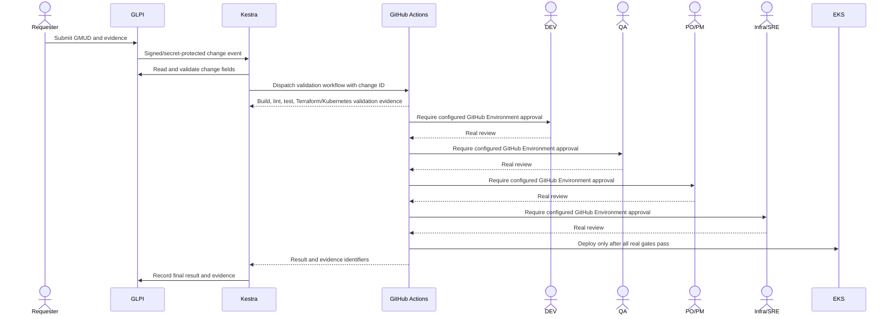

# ITSM Change Gates and Deployment Integration

## Intended flow

The complete integration is **disabled**, pending independent Kestra authentication and a repository GitHub App. The owner confirmed that no Enterprise license is available. Kestra OSS 2.0.8 currently uses one Basic Auth identity; its personal credential was not reused, changed or disabled. The disabled candidate flow in `ops/itsm/kestra/gmud-dev.yaml` has not been uploaded or engine-validated.

## Implemented boundaries

- GLPI 12 OAuth technical user `svc-cosmotech-automation`, isolated entity/profile, no approval rights; credentials in SSM SecureString `/cosmotech/itsm/glpi/automation-credentials`. Actual create/read/update and restart persistence passed for test ticket 1 and change 1. Approval remains None; no human approval was invented.
- Four protected GitHub environments: `dev`, `qa`, `po-pm`, `infra-sre`. Owner-selected reviewer `rlcosmo` is required separately at each stage, administrator bypass disabled, main branch only. Self-review is permitted to accommodate the explicitly selected single owner.
- Repository OIDC subject uses immutable repository/owner IDs, main ref and infra-sre environment. Role `cosmotech-serverless-lab-github-dev-deploy` grants scoped ECR, EKS discovery, catalog read and a fixed SSM port tunnel. Kubernetes can patch only the two current Orders Deployments and cannot read Secrets.
- `deploy-dev.yml` defaults to an approval probe. No AWS credential is requested until four gates and approval-history checks pass. Deploy mode additionally requires `GMUD_INTEGRATION_READY=true` and an unexpired HMAC attestation for the exact commit, change and nonce. The current repository variable is false.
- `src/automation/bridge.py` reads the change through technical GLPI OAuth, validates structured fields, records dispatch intent, uses a repository GitHub App installation token, polls real results/reviews and writes evidence back. Unit tests cover duplicate dispatch, malformed records, redirects, unauthorized endpoints and errors. This bridge has **not been exercised end to end against Kestra/GitHub**.

## Owner setup still required

1. Choose an officially supported way to give this Kestra installation an independent technical identity without replacing the owner's login. Enterprise service accounts are unavailable without a license. Do not enable the candidate flow under the personal identity.
2. Register/install a GitHub App limited to this repository with Actions write and Contents read. Store JSON `app_id`, `installation_id`, `private_key` securely at `/cosmotech/itsm/github/automation-app`; do not send a private key in chat or commit it.
3. After independent authentication and isolated workflow tests pass, test GLPI → Kestra → Actions → GLPI evidence, then enable the repository variable. Approve every real DEV, QA, PO/PM and Infra/SRE gate manually. No unattended approval is implemented.

## Operation and rollback

The bridge expects JSON inside the GLPI change description (HTML `<pre>` is supported). Required fields and validation rules are authoritative in `src/automation/change_control.py`; include explicit deployment intent, environment, justification, risk, impact, implementation/rollback plans and a bounded UTC maintenance window. The existing test GMUD intentionally cannot authorize deployment.

Deploy builds immutable image tags, resolves digests, patches the two current workloads and checks a single synthetic lab order through API/SQS/worker. Previous image digests and results become an Actions artifact, then GLPI evidence. If a rollout fails, preserve evidence and review rollback to recorded images; never roll back DynamoDB contents or reset inventory automatically. New runtime processing has not yet been deployed.

`ops/itsm/create-glpi-service.sh` is idempotent with the existing protected credential file and stops if an existing user cannot be matched safely. `ops/itsm/bootstrap.sh` skips first-install personal account changes on an existing installation. Neither script resets a personal password as part of this continuation.
