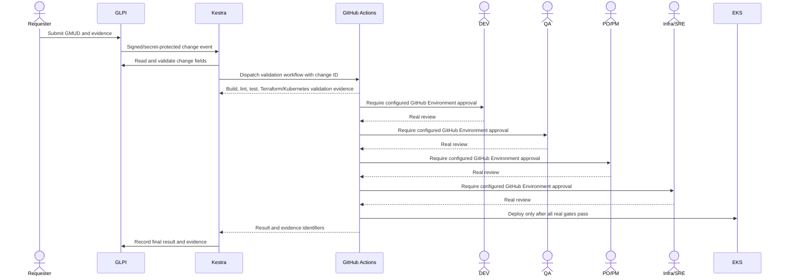

# ITSM Change Gates and Deployment Integration

## Intended flow

This diagram is the target workflow; the complete integration is **not yet enabled**. GitHub Actions currently runs validation only. No deploy job, GLPI webhook, or Kestra flow is active. This prevents a change from bypassing approvals while required real identities and credentials are unavailable.

## Required change record

Before automation can proceed, each GLPI change must include a stable change ID, title, description, justification, requester, owner, environment, risk, impact, implementation plan, rollback plan, maintenance window, approval history, evidence links, and final result. Kestra must fetch the record from GLPI and validate each required field rather than trusting webhook payload values.

## Required real approvals

The GitHub repository currently has **zero deployment environments**. No DEV, QA, PO/PM, or Infra/SRE reviewer groups are configured. Do not create substitute users or treat a workflow run, comment, or check mark as an approval.

After the repository owner supplies real reviewer identities or teams, create protected GitHub Environments for each gate and configure required reviewers in repository settings. A workflow must query the environment protection configuration and stop before deployment if any required environment has no reviewer protection. The approval jobs must run sequentially, preserve reviewer and timestamp evidence, and require all four gates for every change.

## Required API credentials and integrations

GLPI 12's REST API v2 uses OAuth2 and requires a registered OAuth client and an authenticated user; the service account and least-privilege profile have not been configured. Kestra requires a dedicated service identity/API credential for orchestration. GitHub Actions currently has no OIDC role trusted by this repository; the existing ECR role trusts a different repository. Keep all generated credentials in SSM Parameter Store or GitHub Actions secrets with least privilege, and never include them in source, URLs, or logs.

Kestra's core webhook trigger places its key in the URL path. The WAF now redacts URI paths and Nginx access logs omit paths and query strings. Before enabling a webhook, test that access logs, WAF logs, and any downstream evidence contain no webhook key. Rotate the key immediately if it is ever exposed.

## Deployment boundary

There is no tracked source-of-truth manifest or image pipeline for the live EKS Orders workloads, and no least-privilege GitHub OIDC deploy role. Do not dispatch a production or DEV deployment until:

1. The change exists in GLPI and all required fields validate.
2. GitHub Actions validations have passed for the exact commit.
3. All four protected environments contain the expected real reviewers and all approvals are recorded.
4. Terraform/Kubernetes plans are reviewed and show no unsafe replacements or deletions.
5. The repository-specific OIDC role grants only the required DEV deployment actions.
6. Post-deploy checks and evidence upload are configured, and the result can be written back to GLPI.

Until those prerequisites are met, the safe behavior is to leave deploy disabled and record the blocker in [EXECUTION-STATUS.md](EXECUTION-STATUS.md).
