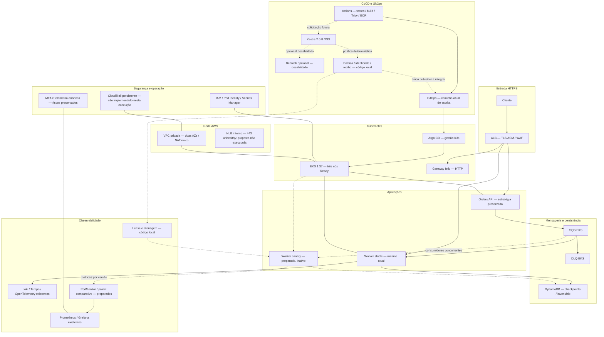
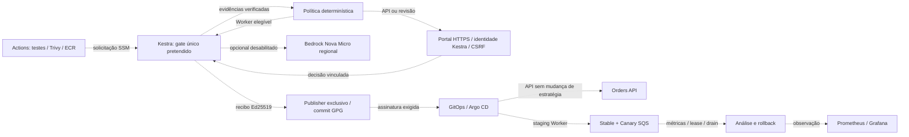
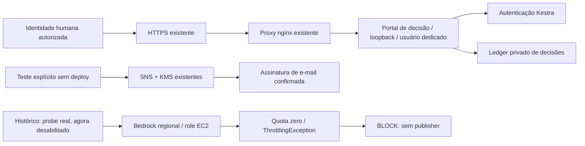

# Arquitetura atual e extensão preparada — estado consolidado

## Estado RCL —06/11/2026

RCL000001/GLPI5: Worker1.0.1 abortado por evidência inicial insuficiente; candidata drenada e stable preservada. RCL000002/GLPI6: API2.0.1-lab aguarda aprovação humana. RCL000003/GLPI7: Worker1.0.2 concluiu Canary1→2, promoção e drenagem, em observação até22:04:27Z de06/11 (19:04:27 em São Paulo). Nenhum encerramento12h antecipado; nenhuma aprovação API pelo agente. As GMUDs anteriores não foram renumeradas.

Diagramas atualizados: [AWS](assets/aws-architecture.svg), [RCL/CI/CD/GLPI/Kestra/GitOps](assets/cicd-gmud-gitops.svg) e [Canary Worker](assets/worker-canary.svg), todos também em PNG. Mostram o desenho e as provas obtidas, sem apresentar observação12h como concluída.

## Snapshots anteriores preservados

Histórico técnico anterior (não é o estado vigente)

# Arquitetura atual e extensão preparada — estado consolidado

> Atualização pós-aprovação —06/11/2026: GMUD3/API e4/Worker aprovadas pelo responsável, deploys concluídos e GLPI em OBSERVING/Review8. API e Worker usaram RollingUpdate; Worker foi bootstrap de telemetria, sem Canary. Kestra agora tem labels aplicação/versão/GMUD, inclusive nas duas execuções existentes. Correção da primeira probe Istio aplicada ao injector para novos pods Orders e validada em dois pods reais isolados, sem Warning/restart. Os diagramas/carrossel existentes são snapshots anteriores às aprovações e precisam de revisão antes de publicação definitiva.

> Snapshot anterior às aprovações — 06/11/2026 UTC (05/11 em São Paulo). A integração real chegou à aprovação humana das GMUDs 3/API e 4/Worker. CI, coleta, política, GLPI, portal/SNS e controle de assinatura estão ativos. Nenhuma release de aplicação foi promovida nesta etapa; Canary, rollback EKS e a janela real de 12h continuam pendentes. Bedrock opcional/desabilitado, sem novas inferências. As seções históricas abaixo não descrevem necessariamente o ambiente atual.

## Diagramas para revisão

- [Arquitetura AWS SVG](assets/aws-architecture.svg) · [PNG](assets/aws-architecture.png)
- [CI/CD, GMUD e GitOps SVG](assets/cicd-gmud-gitops.svg) · [PNG](assets/cicd-gmud-gitops.png)
- [Canary Worker SVG](assets/worker-canary.svg) · [PNG](assets/worker-canary.png)

Legenda: ATIVO = componente/controle observado; HUMANO = revisão obrigatória pendente; ISOLADO = teste local; PLANEJADO = ligação/validação ainda pendente. Setas mostram o fluxo pretendido, não provam execução completa. Não há NLB/CloudTrail ou IA ativa no novo desenho.

## Histórico preservado — anterior à integração GMUD atual

Consultar registros anteriores (não representam o estado vigente)

# Arquitetura atual e extensão preparada

## Estado vigente — 2026-11-06T00:44Z

Kestra determinístico por criticidade; Bedrock opcional e desabilitado. Probe remoto
disabled=true revisão2, portal atualizado e healthcheck200. 101 testes locais e
Ruff passaram. Gate integrado/publisher/enforcement/Canary e rollback reais
continuam pendentes; instalação do GitHub App requer aceitação de Actions read.
Nenhuma aplicação promovida, nova inferência ou SNS Publish nesta retomada.
Plano em [10](10-action-plan.md), provas em [14](14-evidence-index.md).

Os trechos anteriores de preparação são históricos e não anulam esse estado. NLB e CloudTrail permanecem fora do escopo.

Linhas contínuas: arquitetura de referência/estado observado nas consultas documentadas. Linhas pontilhadas: componentes preparados localmente, sem ativação. Cada vínculo continua sujeito ao escopo e à janela do relatório09.

O caminho atual CI→GitOps continua existindo: o diagrama não apresenta o gate novo como obrigatório. A versão final pós-ativação deve remover esse caminho direto somente após enforcement demonstrado. Pesos HTTP do Istio não controlam consumo SQS e não são usados para representar Canary.

## Integração pretendida após a decisão determinística

Todas as linhas deste complemento representam a integração preparada/pretendida, ainda sem ativação ponta a ponta. Não são evidência de implantação.

## Componentes implantados e histórico do probe

O envio foi aceito pelo SNS; entrega no mailbox e decisão humana de release continuam não verificadas. O fluxo principal de promoção, publisher/GPG no destino e Canary EKS continuam preparados ou pendentes, conforme10.

