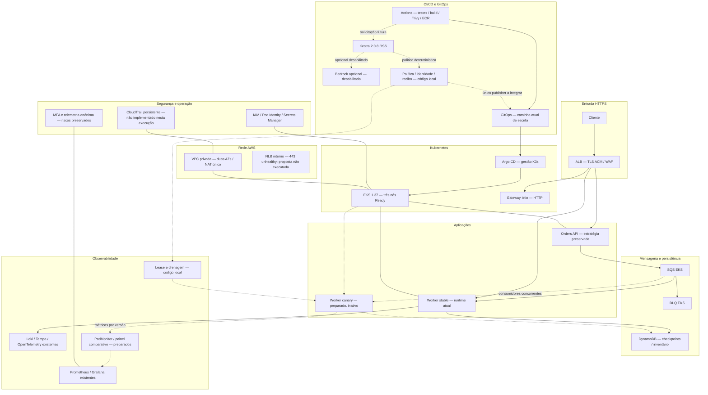
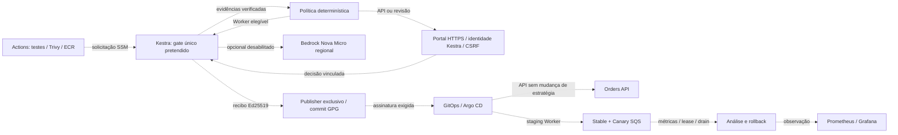
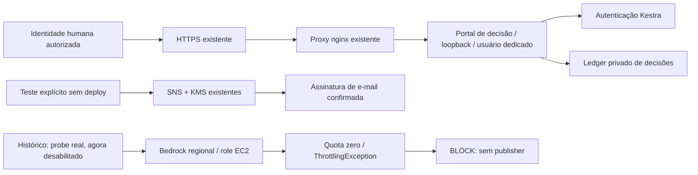

# Arquitetura atual e extensão preparada

## Estado vigente — 2026-11-06T00:44Z

Kestra determinístico por criticidade; Bedrock opcional e desabilitado. Probe remoto
disabled=true revisão2, portal atualizado e healthcheck200. 101 testes locais e
Ruff passaram. Gate integrado/publisher/enforcement/Canary e rollback reais
continuam pendentes; instalação do GitHub App requer aceitação de Actions read.
Nenhuma aplicação promovida, nova inferência ou SNS Publish nesta retomada.
Plano em [10](10-action-plan.md), provas em [14](14-evidence-index.md).

Os trechos anteriores de preparação são históricos e não anulam esse estado. NLB e CloudTrail permanecem fora do escopo.

Linhas contínuas: arquitetura de referência/estado observado nas consultas documentadas. Linhas pontilhadas: componentes preparados localmente, sem ativação. Cada vínculo continua sujeito ao escopo e à janela do relatório09.

O caminho atual CI→GitOps continua existindo: o diagrama não apresenta o gate novo como obrigatório. A versão final pós-ativação deve remover esse caminho direto somente após enforcement demonstrado. Pesos HTTP do Istio não controlam consumo SQS e não são usados para representar Canary.

## Integração pretendida após a decisão determinística

Todas as linhas deste complemento representam a integração preparada/pretendida, ainda sem ativação ponta a ponta. Não são evidência de implantação.

## Componentes implantados e histórico do probe

O envio foi aceito pelo SNS; entrega no mailbox e decisão humana de release continuam não verificadas. O fluxo principal de promoção, publisher/GPG no destino e Canary EKS continuam preparados ou pendentes, conforme10.
