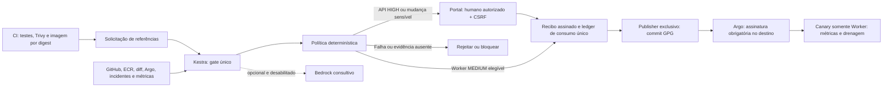

# Gate determinístico por criticidade; IA opcional

Decisão vigente do proprietário: Bedrock deixa de ser requisito de autorização.
Está desabilitado, inclusive no probe remoto (revisão2). Adaptador Converse e
validação de schema permanecem disponíveis para uma futura ativação explícita;
não chamar enquanto quotas zeradas. Não produzir recomendação fictícia.

Diagrama de destino; gate completo/publisher/enforcement/Canary ainda não foram
ativados. Estado e dependência humana em [10](10-action-plan.md), provas em
[14](14-evidence-index.md).

Worker só é automático com testes/scan/digest/contrato válidos, runtime confiável,
incidentes críticos ausentes, dependências revisadas, nenhuma mudança sensível e
enforcement comprovado por adaptadores confiáveis. API sempre exige humano.
Nenhuma revisão humana sobrepõe falha técnica grave. Evidência ausente, stale ou
enforcement não comprovado bloqueiam; campos de formulário não são autoridade.

Recibo Ed25519 vincula serviço/ambiente/commit/digests/manifests/run/execution e
política; expira em10min, registra modo IA e é consumido antes do dispatch.
Falha ambígua exige reconciliação. Portal autentica contra Kestra, allowlist e
CSRF específico da release; registrar decisão não publica GitOps. SNS notifica,
sem aprovação por e-mail ou link bearer. Em modo desabilitado, portal/e-mail
exibem Bedrock desabilitado, sem recomendação simulada.

Na execução Kestra, `verified_evidence` e `deterministic_policy` precisam concluir.
`bedrock_assessment` só é exigida quando o modo confiável está explicitamente
habilitado. CLI e motor usam modo desabilitado por padrão. Não permitir ao CI
escolher o modo ou afirmar que o destino está protegido.

O código existente de publisher GPG, SSM fixo e renderer de AppProject será
reutilizado no cutover. Antes dele, os caminhos antigos de escrita ainda estão
ativos; não alegar gate obrigatório no ambiente. Credenciais de publisher/chaves
não pertencem ao portal, CI das aplicações ou tarefas de IA. Administradores de
AWS/GitHub/Kestra/host/cluster são fronteira privilegiada.

Bloqueio atual: a instalação do GitHub App ainda precisa conceder Actions read
já declarado no App. Sem isso não há coleta autenticada dos testes/Trivy.
Persistência, retenção/backup do ledger, capacidade dos nós, observação por
versão e rollback real precisam de validação operacional antes da conclusão.
