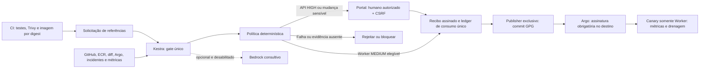

> **Atualização real — 06/11/2026:** retenção aplicada por Deployment: API 11→3, Worker 11→3 e Canary 7→3. Vinte ReplicaSets inativos removidos pelo Kubernetes via GitOps assinado; Argo CD Synced/Healthy. Imagens, pods e HPA preservados. Worker atual 1.0.5; candidato 1.0.6 inativo após rollback anterior a esta manutenção. Não anunciar novo Canary validado. Automação `cdedf49`; GitOps `49e0639`/`0efb05d`. [Evidência sanitizada](assets/replicaset-retention-evidence.json). O restante deste documento e o carrossel preservam seus snapshots históricos; não são capturas deste ajuste.

# Gate determinístico por criticidade; IA opcional — estado consolidado

## Novas releases — duas réplicas estáveis propostas

CIs reais concluídas: Worker1.0.6 (42230662176) e API2.0.4-lab (42230662459), com testes, Trivy e publicação aprovados. As duas candidatas definem HPA `minReplicas=2`, `maxReplicas=2`; `spec.replicas` permanece sob propriedade exclusiva do HPA. Consulta real:2026-11-06T14:08:19.240108+00:00.

| GMUD | Aplicação / candidata | GLPI | Kestra | Estado |
|---|---|---|---|---|
| [RCL000009](https://kestra.cosmotechsolutions.com.br/releases/4477da31afa7306f609cec5aa3550c4e24fff5a06899bd80254483eedfcfc6fd) | orders-api 2.0.4-lab | 13 | 3wN30fLGZrBmhd214817by | Aprovação humana pendente |
| [RCL000010](https://kestra.cosmotechsolutions.com.br/releases/43e5dc66280aa85c1ec7446d61ec19d93d10ffb06583c87b1e73e918f04db2d8) | orders-worker 1.0.6 | 14 | H7O83ddlbuiIXWI5Izh4L | Aprovação humana pendente |

Ambas aguardam decisão autenticada. API é CRÍTICA; Worker continua NÃO CRÍTICA, mas a mudança de HPA é sensível segundo a política vigente. Não houve reclassificação nem aprovação pelo agente. Nenhuma candidata foi promovida nesta consulta; versões atuais continuam API2.0.3-lab e Worker1.0.5, uma réplica pronta cada.

Executor Canary corrigido para congelar o mínimo aprovado do HPA, em vez de forçar uma réplica, preservando o baseline e a capacidade da candidata na promoção. Após drenagem, restaura o HPA aprovado; rollback restaura a configuração anterior. Testes locais: Worker86, API69, automação222 +4 subtestes. Canary continua exclusivo Worker; novo Canary/dados sintéticos e observação12h aguardam autorização e execução real. Não considerar validação isolada como implantação integrada.

Fonte: `assets/two-replica-release-requests.json`. Commits enviados: Worker3db4ff4, API3ff206a, automação b104c04. Nenhum novo nó/recurso AWS provisionado; custos variáveis CI/ECR/chamadas não isolados. O carrossel existente registra as últimas implantações verificadas RCL000007/8; estas novas GMUDs ainda não podem ser anunciadas como implantadas.

## Estado vigente de acesso — consulta nativa Kestra

`laboratorio@cosmotechsolutions.com.br` agora entra no formulário original de https://kestra.cosmotechsolutions.com.br/ com a senha operacional existente. Consulta os mesmos17 fluxos do catálogo administrativo, execuções, logs e dashboards. Admin mantém credenciais, sessões e acessos. Regras antigas abaixo que limitavam essa conta ao portal são históricas.

Como o OSS2.0.8 continua com uma conta nativa global, o acesso adicional é um adaptador protegido no Nginx/portal, não RBAC nativo nem compartilhamento da senha administrativa com o navegador. Sessão opaca Secure/HttpOnly/SameSite=Strict; consultas permitidas, alterações/replay/resume/webhooks bloqueados. Aprovação, rejeição e rollback permanecem no portal com identidade e CSRF. Credencial administrativa só no mapa privado root0600, ilegível pelo serviço do portal. Frontend original preservado.

Validação HTTP real: login204, catálogo de17 fluxos idêntico ao admin, execuções/logs200, consulta real de indicador200, tentativas em recursos inexistentes403, logout204 e acesso após logout401. Sem aprovação ou alteração de fluxo real pelo teste. Admin Basic/cookie200 e login204, inclusive durante breve indisponibilidade controlada do adaptador, com recuperação confirmada. Backend Kestra não foi interrompido. Não há captura de navegador: estes resultados são de protocolo HTTP e fonte da versão instalada.

Evidência: `assets/kestra-native-view-evidence.json`. Código80c3657/d910f15/1063c89; infraestrutura131c443. Testes locais219 +4 subtestes. Sem novas versões de aplicações, GMUDs ou recursos AWS nesta alteração; observação12h continua em aberto. Custos variáveis não isolados.

## Acesso operacional e links CD — correção de06/11/2026

Entrar em https://kestra.cosmotechsolutions.com.br/releases/login como `laboratorio@cosmotechsolutions.com.br`, com a senha existente do laboratório. O alias anterior e o admin foram preservados. O login nativo do Kestra OSS permanece administrativo. `Acompanhar esteira CD` abre etapas/evidências autenticadas no portal; o link técnico usa `/ui/main/executions/...`. Links históricos com `/ui/executions/main/...` recebem308. Validação real: dez links CD200, anônimo401 e zero aprovações pelo teste. Evidência: `assets/operational-email-cd-links-evidence.json`; código59f602f e proxy2f9eae5.

## Referências de imagem por tag — atualização de06/11/2026

Por decisão do proprietário, os Deployments usam o endereço completo do ECR com `worker-1.0.5-16` e `api-2.0.3-lab-19`, sem sufixo `@sha256`. Os dois repositórios são integralmente IMMUTABLE. Digest continua verificado na esteira, registrado nas evidências e utilizado internamente por Canary/rollback. A mudança de formato mantém as versões, decisões e prazos das RCL000007/8; não cria aprovação humana ou nova versão. GitOps continua sendo a fonte oficial. Evidência atual: `assets/tag-only-deployment-evidence.json`. Os exemplos anteriores com tag@digest representam o formato anterior.

## Revisão operacional — 06/11/2026

Estado confirmado em 2026-11-06T12:45:28.826367+00:00. API 2.0.3-lab: aprovação humana autenticada registrada; Worker 1.0.5: aprovação automática pela política. Ambos implantados, Argo CD saudável e em observação. Canary exclusivo Worker concluído com progressão 1→2, promoção e drenagem. Nenhuma aprovação pelo agente.

| RCL | Aplicação / versão | GLPI | Kestra principal | Estado |
|---|---|---|---|---|
| RCL000007 | orders-api 2.0.3-lab | 11 | 7jyFluWNV09PrJqsDc3kVb | OBSERVING |
| RCL000008 | orders-worker 1.0.5 | 12 | 50dZBEpEZFcQPNS8qv56rI | OBSERVING |

Portal principal: https://kestra.cosmotechsolutions.com.br/releases/ · Entrada operacional: https://kestra.cosmotechsolutions.com.br/releases/login. Usuário `laboratorio` criado no portal com hash PBKDF2-SHA256; admin preservado. Kestra OSS 2.0.8 mantém autenticação nativa de administrador; não foi concedido acesso administrativo nativo ao operador. Ações continuam sujeitas a autenticação, CSRF, política e prazo. Decisões futuras como laboratorio dependem da interação real desse usuário; esta API foi aprovada pela identidade admin.

Uma execução `cosmotech.promotion/release_pipeline` por release, com labels RCL/aplicação/versão; scheduler persistente em `cosmotech.operations`. Dez etapas no portal com fatos, horários, duração e evidências; dados históricos sem horário não recebem duração inventada. Execução principal concluída significa entrega inicial, não GMUD encerrada. Filtrar `execution_type=release` para acompanhamento.

Imagens observadas: `worker-1.0.5-16@sha256:…` e `api-2.0.3-lab-19@sha256:…`, com labels de versão e RCL. O número final vem da CI real; a tag aponta para o mesmo digest testado e a referência continua fixada pelo digest. Pods finais: zero reinícios e nenhum Warning na amostra; startup Istio15021 com atraso de5s.

Carga real com dados sintéticos: 800 respostas202, zero erros HTTP, três pedidos consultados como COMPLETED, estoque1800→1000. Janela Canary300s: candidata185,26 e stable101,05 por Prometheus increase; p95≈0,0986s; falhas, poll, visibility e DLQ zero na amostra. Não são contagens exatas de pedidos nem tráfego de produção.

Observação/rollback até 06/11/2026 às21:41:30 (Worker) e21:44:26 (API), horário de São Paulo; UTC07/11 às00:41:30 e00:44:26. Não houve encerramento antecipado. Rollback humano pós-promoção e conclusão real das12h ainda não validados. Rollback automático real da RCL000005 permanece histórico de falha, nunca sucesso.

Indisponibilidade real breve do GLPI foi controlada e recuperada: histórico autenticado200 permaneceu disponível, ações bloqueadas, decisões e efeitos GitOps preservados, zero GMUDs duplicadas. Cache não autoriza promoção. Autenticação real laboratorio: dez detalhes consultados, anônimo/senha incorreta401, acesso nativo Kestra negado e zero POSTs de aprovação no teste.

Sem novos recursos AWS. Custos variáveis de CI, chamadas, mensagens e telemetria não foram isolados. Bedrock desabilitado, sem inferência; NLB/CloudTrail fora do escopo. Capturas reais de UI/anotações permanecem pendentes; diagramas e placeholders não são prints.

### Evidência e utilização deste documento

Três políticas preservadas: API CRÍTICA sempre humana; Worker NÃO CRÍTICA automática condicionada; CRÍTICA CUSTOMIZADA exige cinco últimas GMUDs reais encerradas com sucesso da mesma aplicação/ambiente. Histórico insuficiente/falha/rollback exige humano. Não existem cinco novos sucessos reais após12h nesta rodada; cenários adicionais permanecem testes isolados.

### Commits desta rodada

Automation bb6b9c4; infraestrutura774efd0; Workerdf58807; API8e74c1c. GitOpsAPI ebc0e17; Worker final6a7be69, com etapas intermediárias assinadas registradas na evidência.

Histórico técnico preservado — não representa o estado vigente

# Gate determinístico por criticidade; IA opcional — estado consolidado

## Revisão de execução —06/11/2026

Consulta real: 2026-11-06T11:30:15.400580+00:00. API 2.0.2-lab / RCL000004 / GLPI8: OBSERVING, aprovação humana autenticada pelo responsável. Worker 1.0.4 / RCL000006 / GLPI10: OBSERVING, Canary COMPLETE, aprovação automática condicionada. Nenhuma aprovação da API pelo agente.

Decisão vigente: aprovação determinística por criticidade protegida. CRÍTICA/API sempre humana; NÃO CRÍTICA/Worker automática somente com controles; CUSTOM exige cinco últimas GMUDs reais concluídas sem falha/rollback da mesma aplicação/ambiente. Histórico incompleto e falhas GLPI/política bloqueiam ou exigem humano; não há cinco sucessos reais encerrados demonstrados.

Carga real com dados sintéticos: 800 respostas202 e 0 erros HTTP; três pedidos consultados como COMPLETED. API/SQS/DynamoDB reais; pagamento e expedição são simulações explícitas do laboratório. Startup Istio15021 com5s, sem a falha de conexão anterior nos testes desta rodada. Readiness503 pode ocorrer durante drain deliberado; reinícios e eventos estão registrados por teste.

As janelas de12h continuam abertas, sem encerramento antecipado. Rollback solicitado pelo responsável após promoção ainda não foi executado. Capturas reais de UI e suas anotações seguem pendentes; placeholders não são prints. Bedrock permanece opcional/desabilitado, sem inferências. Nenhuma operação NLB/CloudTrail ou recurso AWS novo; custo variável de chamadas/carga/telemetria não isolado.

## Histórico preservado desta atualização

Snapshot anterior (não é o estado vigente)

# Gate determinístico por criticidade; IA opcional — estado consolidado

## Estado RCL —06/11/2026

RCL000001/GLPI5: Worker1.0.1 abortado por evidência inicial insuficiente; candidata drenada e stable preservada. RCL000002/GLPI6: API2.0.1-lab aguarda aprovação humana. RCL000003/GLPI7: Worker1.0.2 concluiu Canary1→2, promoção e drenagem, em observação até22:04:27Z de06/11 (19:04:27 em São Paulo). Nenhum encerramento12h antecipado; nenhuma aprovação API pelo agente. As GMUDs anteriores não foram renumeradas.

Mantidas as três políticas protegidas: crítica/API humana; não crítica/Worker automática com controles; customizada só após cinco GMUDs reais e auditáveis da mesma app/ambiente, encerradas após12h sem erro/rollback. RCL000001 revertida e RCL000003 aberta não contam como sucessos. CI/IA não reclassificam. Falha GLPI/política/histórico bloqueia. Bedrock permanece opcional e desabilitado, sem mensagens técnicas desnecessárias no portal.

## Snapshots anteriores preservados

Histórico técnico anterior (não é o estado vigente)

# Gate determinístico por criticidade; IA opcional — estado consolidado

> Atualização pós-aprovação —06/11/2026: GMUD3/API e4/Worker aprovadas pelo responsável, deploys concluídos e GLPI em OBSERVING/Review8. API e Worker usaram RollingUpdate; Worker foi bootstrap de telemetria, sem Canary. Kestra agora tem labels aplicação/versão/GMUD, inclusive nas duas execuções existentes. Correção da primeira probe Istio aplicada ao injector para novos pods Orders e validada em dois pods reais isolados, sem Warning/restart. Os diagramas/carrossel existentes são snapshots anteriores às aprovações e precisam de revisão antes de publicação definitiva.

> Snapshot anterior às aprovações — 06/11/2026 UTC (05/11 em São Paulo). A integração real chegou à aprovação humana das GMUDs 3/API e 4/Worker. CI, coleta, política, GLPI, portal/SNS e controle de assinatura estão ativos. Nenhuma release de aplicação foi promovida nesta etapa; Canary, rollback EKS e a janela real de 12h continuam pendentes. Bedrock opcional/desabilitado, sem novas inferências. As seções históricas abaixo não descrevem necessariamente o ambiente atual.

## Aprovação determinística e GMUD

Decisão atual substitui IA obrigatória. Bedrock é opcional/desabilitado; quotas zero não geram novas tentativas. Kestra é o único gate lógico e lê configuração protegida: CRITICAL/API humana; NON_CRITICAL/Worker condicional; CUSTOM_CRITICAL consulta histórico nativo GLPI da mesma app/ambiente.

Custom exige cinco identidades distintas, auditáveis, encerradas com sucesso após 12h, sem erro/rollback. Duplicata/copiação assinada, histórico incompleto, GLPI indisponível ou divergência nativa/journal bloqueiam; ausência de cinco válidas exige humano. CI/IA não fornecem a classificação ou substituem a consulta.

GLPI nativo: New1, Approval10, Accepted7, Testing11, Review8, Closed6, Refused13, Cancelled14. Sucesso técnico entra Review8 por 12h; sucesso final Closed6 só após observação contínua. Falha técnica permanece Review8 com outcome FAILED, sem inventar enum Failed; recusa é Refused13; rollback é Cancelled14 com outcome explícito. Identidade humana é registrada no journal/auditoria do portal; não se fabrica ChangeValidation como se o usuário tivesse autenticado no GLPI.

## Histórico preservado — anterior à integração GMUD atual

Consultar registros anteriores (não representam o estado vigente)

# Gate determinístico por criticidade; IA opcional

Decisão vigente do proprietário: Bedrock deixa de ser requisito de autorização.
Está desabilitado, inclusive no probe remoto (revisão2). Adaptador Converse e
validação de schema permanecem disponíveis para uma futura ativação explícita;
não chamar enquanto quotas zeradas. Não produzir recomendação fictícia.

Diagrama de destino; gate completo/publisher/enforcement/Canary ainda não foram
ativados. Estado e dependência humana em [10](10-action-plan.md), provas em
[14](14-evidence-index.md).

Worker só é automático com testes/scan/digest/contrato válidos, runtime confiável,
incidentes críticos ausentes, dependências revisadas, nenhuma mudança sensível e
enforcement comprovado por adaptadores confiáveis. API sempre exige humano.
Nenhuma revisão humana sobrepõe falha técnica grave. Evidência ausente, stale ou
enforcement não comprovado bloqueiam; campos de formulário não são autoridade.

Recibo Ed25519 vincula serviço/ambiente/commit/digests/manifests/run/execution e
política; expira em10min, registra modo IA e é consumido antes do dispatch.
Falha ambígua exige reconciliação. Portal autentica contra Kestra, allowlist e
CSRF específico da release; registrar decisão não publica GitOps. SNS notifica,
sem aprovação por e-mail ou link bearer. Em modo desabilitado, portal/e-mail
exibem Bedrock desabilitado, sem recomendação simulada.

Na execução Kestra, `verified_evidence` e `deterministic_policy` precisam concluir.
`bedrock_assessment` só é exigida quando o modo confiável está explicitamente
habilitado. CLI e motor usam modo desabilitado por padrão. Não permitir ao CI
escolher o modo ou afirmar que o destino está protegido.

O código existente de publisher GPG, SSM fixo e renderer de AppProject será
reutilizado no cutover. Antes dele, os caminhos antigos de escrita ainda estão
ativos; não alegar gate obrigatório no ambiente. Credenciais de publisher/chaves
não pertencem ao portal, CI das aplicações ou tarefas de IA. Administradores de
AWS/GitHub/Kestra/host/cluster são fronteira privilegiada.

Bloqueio atual: a instalação do GitHub App ainda precisa conceder Actions read
já declarado no App. Sem isso não há coleta autenticada dos testes/Trivy.
Persistência, retenção/backup do ledger, capacidade dos nós, observação por
versão e rollback real precisam de validação operacional antes da conclusão.

