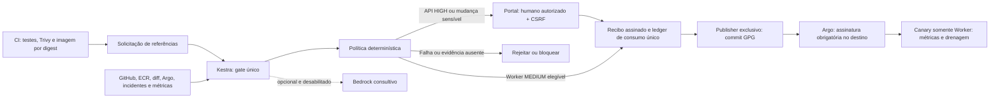

# Gate determinístico por criticidade; IA opcional — estado consolidado

## Estado RCL —06/11/2026

RCL000001/GLPI5: Worker1.0.1 abortado por evidência inicial insuficiente; candidata drenada e stable preservada. RCL000002/GLPI6: API2.0.1-lab aguarda aprovação humana. RCL000003/GLPI7: Worker1.0.2 concluiu Canary1→2, promoção e drenagem, em observação até22:04:27Z de06/11 (19:04:27 em São Paulo). Nenhum encerramento12h antecipado; nenhuma aprovação API pelo agente. As GMUDs anteriores não foram renumeradas.

Mantidas as três políticas protegidas: crítica/API humana; não crítica/Worker automática com controles; customizada só após cinco GMUDs reais e auditáveis da mesma app/ambiente, encerradas após12h sem erro/rollback. RCL000001 revertida e RCL000003 aberta não contam como sucessos. CI/IA não reclassificam. Falha GLPI/política/histórico bloqueia. Bedrock permanece opcional e desabilitado, sem mensagens técnicas desnecessárias no portal.

## Snapshots anteriores preservados

Histórico técnico anterior (não é o estado vigente)

# Gate determinístico por criticidade; IA opcional — estado consolidado

> Atualização pós-aprovação —06/11/2026: GMUD3/API e4/Worker aprovadas pelo responsável, deploys concluídos e GLPI em OBSERVING/Review8. API e Worker usaram RollingUpdate; Worker foi bootstrap de telemetria, sem Canary. Kestra agora tem labels aplicação/versão/GMUD, inclusive nas duas execuções existentes. Correção da primeira probe Istio aplicada ao injector para novos pods Orders e validada em dois pods reais isolados, sem Warning/restart. Os diagramas/carrossel existentes são snapshots anteriores às aprovações e precisam de revisão antes de publicação definitiva.

> Snapshot anterior às aprovações — 06/11/2026 UTC (05/11 em São Paulo). A integração real chegou à aprovação humana das GMUDs 3/API e 4/Worker. CI, coleta, política, GLPI, portal/SNS e controle de assinatura estão ativos. Nenhuma release de aplicação foi promovida nesta etapa; Canary, rollback EKS e a janela real de 12h continuam pendentes. Bedrock opcional/desabilitado, sem novas inferências. As seções históricas abaixo não descrevem necessariamente o ambiente atual.

## Aprovação determinística e GMUD

Decisão atual substitui IA obrigatória. Bedrock é opcional/desabilitado; quotas zero não geram novas tentativas. Kestra é o único gate lógico e lê configuração protegida: CRITICAL/API humana; NON_CRITICAL/Worker condicional; CUSTOM_CRITICAL consulta histórico nativo GLPI da mesma app/ambiente.

Custom exige cinco identidades distintas, auditáveis, encerradas com sucesso após 12h, sem erro/rollback. Duplicata/copiação assinada, histórico incompleto, GLPI indisponível ou divergência nativa/journal bloqueiam; ausência de cinco válidas exige humano. CI/IA não fornecem a classificação ou substituem a consulta.

GLPI nativo: New1, Approval10, Accepted7, Testing11, Review8, Closed6, Refused13, Cancelled14. Sucesso técnico entra Review8 por 12h; sucesso final Closed6 só após observação contínua. Falha técnica permanece Review8 com outcome FAILED, sem inventar enum Failed; recusa é Refused13; rollback é Cancelled14 com outcome explícito. Identidade humana é registrada no journal/auditoria do portal; não se fabrica ChangeValidation como se o usuário tivesse autenticado no GLPI.

## Histórico preservado — anterior à integração GMUD atual

Consultar registros anteriores (não representam o estado vigente)

# Gate determinístico por criticidade; IA opcional

Decisão vigente do proprietário: Bedrock deixa de ser requisito de autorização.
Está desabilitado, inclusive no probe remoto (revisão2). Adaptador Converse e
validação de schema permanecem disponíveis para uma futura ativação explícita;
não chamar enquanto quotas zeradas. Não produzir recomendação fictícia.

Diagrama de destino; gate completo/publisher/enforcement/Canary ainda não foram
ativados. Estado e dependência humana em [10](10-action-plan.md), provas em
[14](14-evidence-index.md).

Worker só é automático com testes/scan/digest/contrato válidos, runtime confiável,
incidentes críticos ausentes, dependências revisadas, nenhuma mudança sensível e
enforcement comprovado por adaptadores confiáveis. API sempre exige humano.
Nenhuma revisão humana sobrepõe falha técnica grave. Evidência ausente, stale ou
enforcement não comprovado bloqueiam; campos de formulário não são autoridade.

Recibo Ed25519 vincula serviço/ambiente/commit/digests/manifests/run/execution e
política; expira em10min, registra modo IA e é consumido antes do dispatch.
Falha ambígua exige reconciliação. Portal autentica contra Kestra, allowlist e
CSRF específico da release; registrar decisão não publica GitOps. SNS notifica,
sem aprovação por e-mail ou link bearer. Em modo desabilitado, portal/e-mail
exibem Bedrock desabilitado, sem recomendação simulada.

Na execução Kestra, `verified_evidence` e `deterministic_policy` precisam concluir.
`bedrock_assessment` só é exigida quando o modo confiável está explicitamente
habilitado. CLI e motor usam modo desabilitado por padrão. Não permitir ao CI
escolher o modo ou afirmar que o destino está protegido.

O código existente de publisher GPG, SSM fixo e renderer de AppProject será
reutilizado no cutover. Antes dele, os caminhos antigos de escrita ainda estão
ativos; não alegar gate obrigatório no ambiente. Credenciais de publisher/chaves
não pertencem ao portal, CI das aplicações ou tarefas de IA. Administradores de
AWS/GitHub/Kestra/host/cluster são fronteira privilegiada.

Bloqueio atual: a instalação do GitHub App ainda precisa conceder Actions read
já declarado no App. Sem isso não há coleta autenticada dos testes/Trivy.
Persistência, retenção/backup do ledger, capacidade dos nós, observação por
versão e rollback real precisam de validação operacional antes da conclusão.

