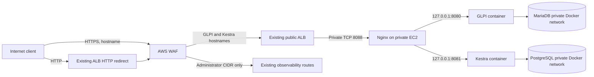

# Public GLPI and Kestra Access

## Architecture

The services run on the private EC2 instance `i-0def4e806c49cf60e` (`10.20.11.150`) in the existing VPC. The instance has no public IP. Docker publishes GLPI only to `127.0.0.1:8080` and Kestra only to `127.0.0.1:8081`; MariaDB and PostgreSQL are only on private Docker networks and have no host port mappings.



## DNS and TLS

The authoritative DNS zone `cosmotechsolutions.com.br` uses Cloudflare. The required CNAMEs already existed before this deployment, so no DNS credentials or changes were needed:

| Name | Existing CNAME target |
| --- | --- |
| `glpi.cosmotechsolutions.com.br` | `k8s-observability-633f55bc55-702046070.us-east-1.elb.amazonaws.com` |
| `kestra.cosmotechsolutions.com.br` | `k8s-observability-633f55bc55-702046070.us-east-1.elb.amazonaws.com` |

The ALB uses the issued ACM certificate `*.cosmotechsolutions.com.br`. HTTP requests are redirected to HTTPS by the existing ALB listener. The certificate chain and both hostnames were verified with `curl` and `openssl`; the current certificate expires on May 19, 2027. DNS records are managed outside this repository. If either record changes, point it to the current ALB DNS name shown by `terraform -chdir=terraform/environments/dev output` and verify the Cloudflare proxy mode and TLS settings.

## Routing and network controls

Terraform manages a dedicated IP target group for private EC2 address `10.20.11.150:8088`, its health check at `/healthz`, and one HTTPS listener rule for the two hostnames. The rule has reserved priority 100 after the AWS Load Balancer Controller's current priorities. Keep this priority clear if adding routes to the shared listener.

The ALB security group accepts TCP 80/443 from the Internet. AWS WAF is associated with the ALB and has a block default action. It allows only the GLPI/Kestra hostnames publicly, permits other routed hosts only from the EKS administrator `/32`, and blocks ITSM hosts after 1,200 requests per source IP within five minutes. The EC2 security group accepts TCP 8088 from the ALB security group only. Do not add public EC2 ingress or expose ports 8080, 8081, 3306, or 5432.

The WAF allow rule publishes the normal GLPI login page and Kestra's authenticated UI. GLPI uses its application login. Kestra uses configured HTTP Basic Authentication; unauthenticated API access was verified to return HTTP 401. Keep credentials in encrypted SSM Parameter Store and the instance's protected runtime file. Do not store them in Git or URLs.

## Access logs and privacy

- AWS WAF access logs are sent to CloudWatch Logs group `aws-waf-logs-cosmotech-public-ingress`, with 30-day retention. WAF request sampling is disabled. Authorization headers, Cookie headers, and query strings are redacted in the WAF logs.
- Nginx writes `/var/log/nginx/itsm-access.log` and `/var/log/nginx/itsm-error.log` on the encrypted EC2 root volume. The access format includes `$uri` but excludes query strings, request headers, request bodies, and referrers.
- WAF logs retain client source IPs; restrict log-group access to authorized operators and follow the 30-day retention setting.

## Operations

After changing Nginx configuration, validate and reload it on the instance:

```bash
sudo nginx -t
sudo systemctl reload nginx
curl --fail --silent http://127.0.0.1:8088/healthz
```

The reproducible installer is `ops/itsm/install-public-proxy.sh`; the instance can be administered with AWS Systems Manager Session Manager. Terraform changes should be planned and reviewed before applying. Do not change the ingress CIDR without confirming the WAF association remains active.

External smoke checks:

```bash
curl -sSI http://glpi.cosmotechsolutions.com.br/
curl -sSI https://glpi.cosmotechsolutions.com.br/
curl -sSI http://kestra.cosmotechsolutions.com.br/
curl -sS -o /dev/null -w '%{http_code}\n' https://kestra.cosmotechsolutions.com.br/api/v1/instance
```

Expected results: HTTP redirects to HTTPS, GLPI login page responds successfully, and a Kestra API request without credentials returns 401.

## Rollback

To remove public host routing, first restore the ALB inbound CIDR to the administrator `/32` and verify the existing dashboards. Then remove the Terraform-managed listener rule and target group through a reviewed Terraform change. Keep WAF, the existing ALB, ACM certificate, DNS records, EC2, and application data. Do not remove Docker volumes or databases as part of a routing rollback.

## Current validation

On November 4, 2026, both CNAMEs resolved to the shared ALB, both certificates validated, HTTP returned 301 to HTTPS, GLPI returned 200, Kestra UI redirected to `/ui/`, and an unauthenticated Kestra API request returned 401. The Terraform target `10.20.11.150:8088` reported healthy. WAF CloudWatch Logs contained 71 access events during the initial smoke checks.
